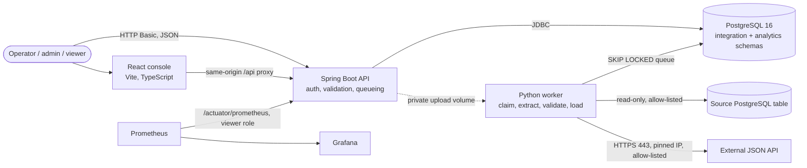

# PIDEA

PIDEA (Enterprise Application Integration & Data Engineering Platform) is an API-first integration and data-processing MVP. The current implementation uses a Java/Spring Boot API, PostgreSQL as the durable job queue and data store, and a Python worker for validation, transformation, quarantine, and idempotent loading. A React + TypeScript console lives in [`frontend/`](frontend/README.md).

## Current capabilities

- Register and manage integration-source metadata with role-checked REST endpoints.
- Submit up to 1,000 JSON records per request, receive a durable asynchronous job, and safely retry client submissions with an idempotency key.
- Upload private CSV/JSON files (5 MiB / 100,000-record limits) into durable file jobs consumed by the same worker pipeline.
- Poll job status, review paged job history, and inspect safe rejection diagnostics.
- Validate and normalize customer, order, and payment-event records; apply declarative field mappings; quarantine invalid records.
- Load business records with unique natural keys and PostgreSQL upserts.
- Pull rows from an allow-listed PostgreSQL table with a read-only session, a key-column checkpoint and a secretRef-resolved password (`POSTGRES_TABLE`).
- Trigger HTTPS `HTTP_API` pulls using a hostname allow-list, DNS-to-IP pinning, TLS hostname verification, bounded JSON pagination and response size, and the worker retry policy.
- Persist schedules for HTTP API pulls and replay failed jobs without discarding original attempts or source input.
- Retry transient worker/database failures with exponential backoff and jitter; recover stale worker claims without allowing an old attempt to overwrite a newer one.
- Record audit events, correlation IDs, execution attempts, and health/metrics endpoints.
- Run the API and worker with separate, least-privilege database roles using Docker Compose.

The REST adapter has deterministic mock-response and pinned-transport tests; it has not been verified against a live external service. `POSTGRES_TABLE` sources can be pulled by the worker (see "PostgreSQL table connector" below); the connector is verified against a local PostgreSQL only. There is no OAuth client, webhook, or live CRM/ERP connector. HTTP pulls are read-only GETs; transient HTTP 429/5xx and network timeouts use the existing bounded worker retries, while other HTTP errors fail the job.

## Architecture and data flow



How one record travels:

1. **Intake.** A client posts JSON, uploads a CSV/JSON file, or triggers a pull. The API authenticates the caller, enforces the role, checks the idempotency key and writes a `PENDING` job (plus the raw records or file reference) in one transaction. It answers `202 Accepted`; it does not process anything itself.
2. **Claim.** The worker polls PostgreSQL and claims one runnable job with `FOR UPDATE SKIP LOCKED`, so several workers never take the same job. A heartbeat row tells the API the worker is alive.
3. **Extract.** Push jobs read their stored records, file jobs read the private upload, and pull jobs call a connector (`HTTP_API` or `POSTGRES_TABLE`) that returns the next batch and, for databases, a checkpoint.
4. **Transform and validate.** Pydantic models normalise customers, orders and payment events and apply the source's declarative field mapping. Invalid records get a reason code and are quarantined; values are never copied into diagnostics.
5. **Load.** Valid records are upserted by natural key. Loading, quarantine rows, counters, the checkpoint and the job status are committed in **one transaction**, so a job is never half-applied.
6. **Outcome.** Transient failures retry with exponential backoff and jitter; permanent ones fail with a curated message. A `FAILED` job can be replayed once. Metrics, logs (with the request's correlation id) and the console all read this same state.

- `backend/` contains the Java 21 / Spring Boot 3.5 API, Spring Security, JPA source metadata, JDBC job operations, Actuator, OpenAPI, and Flyway migrations.
- `data-engine/` contains the Python 3.12+ worker, Pydantic validation, file extractors, transformation, retry handling, and PostgreSQL loaders.
- Flyway owns DDL. Both services share the `integration` and `analytics` schemas but have separate runtime database roles. The API role has no `analytics` schema access; the worker role has the DML access needed to load analytics records.
- API uploads use a private shared Docker volume; the API writes generated filenames and the worker reads them without exposing the volume over HTTP.
- `backend/src/main/resources/db/migration/` is the authoritative schema history. Hibernate uses `ddl-auto: validate`; it does not create or modify schema objects.
- The existing integration tests use Testcontainers and apply the real Flyway schema to PostgreSQL 16.

## Technology stack

| Layer | Technology |
| --- | --- |
| API | Java 21, Spring Boot 3.5, Spring Security (HTTP Basic, method security), Spring JDBC/JPA, Flyway, Actuator + Micrometer, springdoc OpenAPI |
| Worker | Python 3.12, psycopg 3, Pydantic, requests (pinned-IP TLS adapter), bcrypt for the hash helper |
| Database | PostgreSQL 16 (job queue, raw/quarantine records, analytics tables) |
| Console | React 19, TypeScript, Vite, Tailwind CSS, React Router |
| Tests | JUnit 5 + Testcontainers, pytest + Testcontainers, Vitest + Testing Library, Playwright + axe-core |
| Operations | Docker Compose (core, `demo`, `observability` profiles), Prometheus, Grafana, GitHub Actions, Dependabot, Trivy |

## Prerequisites

- Docker Desktop (or another Docker engine) with Compose v2, running. The test suites also use it through Testcontainers.
- Node.js 20 or newer (22 in CI) for the console and the Playwright tests.
- Windows PowerShell for `scripts/dev-up.ps1` / `dev-down.ps1`. The verification scripts (`scripts/*.sh`) need bash (Git Bash on Windows) and Node.
- Java 21 only if you run the backend outside Docker; Python 3.12 only to generate password hashes or run the worker tests outside Docker (the Maven wrapper and test containers cover everything else).
- Git. Shell scripts are pinned to LF line endings by `.gitattributes` so they work inside Linux containers on any checkout.

## Quick start (Windows PowerShell)

```powershell
.\scripts\dev-up.ps1      # checks tools, creates .env if missing, starts db/api/worker, waits for health, starts the console
.\scripts\dev-down.ps1    # stops everything; database and upload volumes are kept
```

`dev-up.ps1` never overwrites an existing `.env`. If `PIDEA_DB_PORT` is not set and host port 5432 is taken, it uses a free port for that run (best-effort: another process could still claim it before Docker binds, in which case Compose fails with a clear error). Set `PIDEA_DB_PORT` in `.env` to pin a port. Only the host-published port changes; containers always reach PostgreSQL at `db:5432`. The console is served at `http://127.0.0.1:5173` (loopback only) and the API at `http://127.0.0.1:8080`. Sign-in requires a BCrypt hash in `PIDEA_ADMIN_PASSWORD_HASH` (see below).

Startup resilience: the database health check tests TCP connectivity (not just the Unix socket), Compose starts the API only once the database is healthy, Flyway retries the connection up to 10 times, the connection pool waits up to 30 s at startup (`PIDEA_DB_STARTUP_TIMEOUT_MS`), and the worker reconnects with capped exponential backoff.

## Run the local stack

From the repository root in PowerShell:

```powershell
if (-not (Test-Path .env)) {
  Copy-Item .env.example .env
} else {
  Write-Output '.env already exists; keep it and edit only the settings you intend to change.'
}
```

Set unique, strong values for `POSTGRES_PASSWORD`, `PIDEA_DB_PASSWORD`, and `PIDEA_WORKER_DB_PASSWORD` in `.env`. Generate BCrypt password hashes from the repository root with:

```powershell
py -3.12 -m pip install -e '.\data-engine[dev]'
py -3.12 .\scripts\new_password_hash.py
```

The script prompts for a password without accepting it as a command-line argument. Put the resulting hash into `PIDEA_ADMIN_PASSWORD_HASH` (and optionally the operator/viewer hash settings) in `.env`. No account is created for a blank hash. Never commit `.env` or use production passwords in local development.

Start the services:

```powershell
docker compose up --build -d
docker compose ps
```

On first startup, PostgreSQL creates the runtime roles and the API applies Flyway migrations. The worker waits for the API health check before starting. Compose binds API and database ports to localhost only. Check health at `http://localhost:8080/actuator/health` and interactive API documentation at `http://localhost:8080/swagger-ui/index.html`.

If the default host ports are already occupied, set `PIDEA_DB_PORT` and/or `PIDEA_API_PORT` in `.env` to unused local ports before startup. The named `pidea-db` and `pidea-uploads` volumes are scoped to the Compose project name.

The named database volume persists across restarts. Do not remove it as a routine troubleshooting step; doing so deletes local database contents.

To pause the services without removing containers or persistent data:

```powershell
docker compose stop
```

Resume with `docker compose start`. To remove the containers and Compose network while retaining the named data volumes, use `docker compose down` without `-v`. Do not use `docker compose down -v` unless you intentionally want to delete the local database and uploads.

## Main API workflow

All `/api/**` endpoints require HTTP Basic authentication and role authorization. The `admin`, `operator`, and `viewer` usernames and example calls below are development/demo conventions only; use unique passwords and TLS, and do not reuse them in production.

1. Create a REST-push source as an administrator:

```sh
curl -u admin:'<password>' -H 'Content-Type: application/json' \
  -d '{"name":"demo-customers","type":"REST_PUSH","config":{}}' \
  http://localhost:8080/api/v1/integration-sources
```

Save the returned `id` as `SOURCE_ID`.

Example source response:

```json
{
  "id": "4c956e25-6678-4c50-8abe-3d33faed3813",
  "name": "demo-customers",
  "type": "REST_PUSH",
  "status": "ACTIVE",
  "config": {},
  "secretConfigured": false,
  "createdAt": "2025-01-01T00:00:00Z",
  "updatedAt": "2025-01-01T00:00:00Z"
}
```

2. Submit records as an operator. Use a new stable key for each logical submission; a retry with the same key and body returns the original job.

```sh
curl -u operator:'<password>' -H 'Content-Type: application/json' \
  -H 'Idempotency-Key: customer-batch-0001' \
  -d '{"sourceId":"<SOURCE_ID>","entityType":"CUSTOMER","records":[{"customer_id":"C100","full_name":"Example Customer","email":"customer@example.test","created_at":"2025-01-01T00:00:00Z"}]}' \
  http://localhost:8080/api/v1/ingestion/jobs
```

The first response is `202 Accepted`: the job is queued, not yet complete. Poll `GET /api/v1/ingestion/jobs/{jobId}` until it reaches a terminal status. `GET /api/v1/ingestion/jobs` returns paged history; `GET /api/v1/ingestion/jobs/{jobId}/errors` returns paged reason codes and safe diagnostics, not raw source payloads. Reusing a key with a different body returns `422`.

Example initial job response:

```json
{
  "id": "8d5cf3ab-a395-4d68-ad15-1105d39b1dd7",
  "sourceId": "4c956e25-6678-4c50-8abe-3d33faed3813",
  "jobType": "RECORDS",
  "entityType": "CUSTOMER",
  "status": "PENDING",
  "correlationId": "a0844889-a632-4c50-b539-f75afc5e6b75",
  "recordsReceived": 1,
  "recordsAccepted": 0,
  "recordsRejected": 0,
  "recordsDuplicate": 0,
  "errorSummary": null,
  "retryCount": 0,
  "maxRetries": 3,
  "submittedAt": "2025-01-01T00:00:00Z",
  "startedAt": null,
  "completedAt": null,
  "durationMs": null
}
```

The REST contracts, validation schemas, authentication scheme, and error responses are also published by the OpenAPI UI. Health is public; actuator exposes only configured health/info/metrics endpoints.

### Upload and execute a file job

Register a `CSV_FILE` or `JSON_FILE` source, then upload a UTF-8 file with a unique idempotency key:

```sh
curl -u operator:'<password>' -H 'Idempotency-Key: customers-file-0001' \
  -F "sourceId=<SOURCE_ID>" -F "entityType=CUSTOMER" \
  -F "file=@customers.csv;type=text/csv" \
  http://localhost:8080/api/v1/ingestion/jobs/files
```

The endpoint validates extension/source type, encoding, CSV structure or JSON array shape, record count, and byte size before accepting a job. Worker-side record schema validation remains the same as for JSON record submissions. Invalid records are quarantined; file-level parse errors fail the job. Successful/partial files are deleted after processing. Failed files remain available for replay for up to 30 days; older failed uploads and abandoned temporary files are cleaned by the worker.

### Pull from an allow-listed HTTPS JSON endpoint

Create an `HTTP_API` source with a `baseUrl`. Optional config keys are `pageSize` (1-1000), `maxPages` (1-1000), `timeoutSeconds` (1-60), `pageParam`, and `pageSizeParam`. The endpoint returns a JSON array or `{"records":[...],"hasMore":false}`. Pages use query parameters (default `page` and `size`) and each response is limited to 5 MiB. `hasMore` controls continuation; without it, a short page ends the pull.

Set the worker's exact outbound hostname allow-list in `PIDEA_HTTP_API_ALLOWED_HOSTS`. Every DNS answer must be a public unicast address; HTTPS on port 443 is required. The adapter connects directly to one validated IP while preserving the configured hostname for TLS SNI, certificate hostname verification, and the HTTP `Host` header. It disables environment proxies and redirects, rejects mixed public/prohibited DNS answers, and fails closed on DNS errors or its bounded DNS timeout. Connection/read timeouts, streamed 5 MiB page limits, bounded pagination, and capped worker retries apply. Store bearer credentials only in `PIDEA_HTTP_API_BEARER_TOKEN` (or another dedicated worker environment variable) and set source `secretRef` to that variable name. Authorization is sent only to the allow-listed source host and is never forwarded through redirects.

Queue one pull:

```sh
curl -u operator:'<password>' -H 'Idempotency-Key: customers-pull-0001' -X POST \
  'http://localhost:8080/api/v1/ingestion/sources/<HTTP_SOURCE_ID>/jobs?entityType=CUSTOMER'
```

Create a durable schedule as an administrator with `POST /api/v1/integration-schedules` and body `{"sourceId":"<HTTP_SOURCE_ID>","entityType":"CUSTOMER","intervalSeconds":3600}`. Schedules accept intervals from 60 seconds to 30 days. The scheduler stores the next tick in PostgreSQL and uses row locks, so multiple API instances do not enqueue the same schedule tick. On restart, due work is recovered from the database; missed intervals are coalesced into one run rather than replayed as a backlog.

### Inspect and replay jobs

Filter the paginated list with `sourceId`, `status`, `submittedFrom`, and `submittedTo` ISO-8601 timestamps. `GET /api/v1/ingestion/jobs/{jobId}/attempts` returns paginated safe attempt diagnostics. Source health includes accepted/rejected counts and recent failed/completed job counts.

An `ADMIN` or `OPERATOR` may `POST /api/v1/ingestion/jobs/{jobId}/replay` for a `FAILED` job. The replay is a new job linked with `replayOf`, copies the original raw request or reuses the private uploaded file, and preserves the original attempt history. A unique database constraint makes repeated replay requests return the same replay job; only failed jobs can be replayed. Natural-key upserts prevent duplicate analytics rows. Partially successful jobs are not replayed automatically, avoiding reapplication of accepted financial records.

### Quarantined records

`GET /api/v1/ingestion/rejected-records` lists quarantined records across all jobs, newest first (`ADMIN` and `OPERATOR` only; viewers get 403). Optional filters, combined with AND: `sourceId`, `jobId`, `entityType`, `reasonCode` (UPPER_SNAKE_CASE), `processedFrom`, `processedTo`; `page` and `size` (capped at 100). Each item has the job, source, entity type, record reference, reason code and safe diagnostics; the raw source payload is never stored or returned. `GET /api/v1/ingestion/rejected-records/reasons` returns the distinct reason codes with counts (optionally for one `sourceId`) for building filters. The per-job view `GET /api/v1/ingestion/jobs/{jobId}/errors` is unchanged. There is no per-record replay: replay works on a whole `FAILED` job (see above), and quarantined records of a partially successful job stay quarantined.

### PostgreSQL table connector (`POSTGRES_TABLE`)

Reads rows from one table of an external PostgreSQL database into the normal pipeline (same validation, mapping, quarantine, idempotent upserts, job status, retries and replay as every other source).

1. **Give the worker permission to connect.** Add the source's exact `host:port` to `PIDEA_PG_SOURCE_ALLOWED_HOSTS` in `.env` (comma-separated, no wildcards). Empty means no database source can be pulled. Store the password in a worker environment variable whose name starts with `PIDEA_SRC_` (for example `PIDEA_SRC_CRM_PASSWORD`) and pass it through to the worker service in Compose.
2. **Create a read-only account on the source.** `CREATE ROLE pidea_reader LOGIN PASSWORD '…'; GRANT USAGE ON SCHEMA crm TO pidea_reader; GRANT SELECT ON crm.customers TO pidea_reader;` and nothing else. The worker also opens a read-only session, so even a more privileged account cannot write through this connector.
3. **Register the source** (admin). The config holds no password; `secretRef` is only the variable's *name*:

```sh
curl -u admin:'<password>' -H 'Content-Type: application/json' -d '{
  "name":"crm-customers","type":"POSTGRES_TABLE","secretRef":"PIDEA_SRC_CRM_PASSWORD",
  "config":{"host":"crm-db.internal","port":5432,"database":"crm","user":"pidea_reader","sslmode":"verify-full",
            "schema":"public","table":"customers","keyColumn":"id","batchSize":500,"maxRows":10000}}' \
  http://localhost:8080/api/v1/integration-sources
```

4. **Trigger a pull** (operator): `POST /api/v1/ingestion/sources/{id}/jobs?entityType=CUSTOMER` with an `Idempotency-Key` header, exactly as for `HTTP_API`. Column names must match the entity's field names, or define a field mapping.

Config keys: required `host`, `database`, `user`, `schema`, `table`, `keyColumn`; optional `port` (5432), `sslmode` (`require` by default; `disable`, `prefer`, `verify-ca`, `verify-full` also accepted), `columns` (comma-separated, default all; the key column is always included), `batchSize` (1-5000, default 500), `maxRows` (1-100000, default 10000), `timeoutSeconds` (1-120, default 30).

**How extraction works and what it guarantees**

- `keyColumn` must be a single-column `UNIQUE NOT NULL` column of an integer, numeric, date or timestamp type (a primary key such as a serial id works). The worker verifies this in the catalogue and refuses otherwise.
- Each job reads at most `maxRows` rows with `key > checkpoint`, ordered by key, streamed through a server-side cursor in `batchSize` chunks. Peak worker memory is therefore bounded by `maxRows` (default 10,000; at most 100,000, the same limit as file uploads). A larger table is ingested over several jobs.
- The checkpoint (`integration.source_checkpoint`) is advanced in the **same transaction** as the load, only when the job ends `SUCCEEDED` or `PARTIALLY_SUCCEEDED` (rejected rows are quarantined and the checkpoint moves past them). A `FAILED` job, a retry or a crash leaves it unchanged. Concurrent pulls of one source are serialised by a row lock. Changing `schema`, `table` or `keyColumn` resets the checkpoint (a full re-read, which is safe because loads are upserts).
- Delivery is **at-least-once with idempotent upserts**, not exactly-once. Rows that are updated or inserted with a key at or below the checkpoint are not picked up (use an ever-increasing key). Deletes are not detected. Binary (`bytea`) columns are refused.
- Errors are classified: bad credentials, wrong database, missing table/column, a non-unique key, a host outside the allow-list or an invalid config fail the job permanently with a curated message (no password, host or SQL is echoed); network failures and timeouts retry with the normal backoff.
- Scheduling is currently available for `HTTP_API` sources only; trigger database pulls through the API or console.

**Adding another pull connector.** The `HTTP_API` and `POSTGRES_TABLE` pulls both implement one small interface, `PullConnector` in [connectors.py](data-engine/src/pidea_data/connectors.py): `pull(config, secret_ref, checkpoint) -> PullBatch`. The worker owns everything around it (source checks, checkpoint locking and atomic advance, error-to-retry mapping, mapping/validation/quarantine, loading, status, replay), so a new connector (OAuth REST, webhook drain, another database) only produces records. The module docstring lists the four steps, including the platform-side pieces (enum values, a Flyway migration widening the two CHECK constraints, config validation, and the job-type mapping in `IngestionService.submitPull`). `tests/test_connectors.py` proves the claim with a connector written only against the interface. Webhooks, OAuth and further databases are not implemented.

**Try it locally** with the seeded demo source (synthetic data, SELECT-only role, no published port): set `PIDEA_DEMO_SOURCE_PASSWORD` and `PIDEA_PG_SOURCE_ALLOWED_HOSTS=demo-source:5432` in `.env`, run `docker compose --profile demo up -d --build`, then register a source with `host=demo-source`, `database=crm`, `user=pidea_reader`, `sslmode=disable`, `schema=crm`, `table=customers`, `keyColumn=id` and `secretRef=PIDEA_SRC_DEMO_PASSWORD`. `bash scripts/verify-pg-connector.sh` automates the whole scenario (batching, quarantine, resume, a new row, a safe failure and replay) on an isolated throwaway stack and is also run in CI.

## Configuration

See [.env.example](./.env.example) for the supported local Compose variables. Important settings:

| Variable | Purpose |
| --- | --- |
| `POSTGRES_DB`, `POSTGRES_USER`, `POSTGRES_PASSWORD` | Local database and schema-owner credentials |
| `PIDEA_DB_PASSWORD` | API runtime database password |
| `PIDEA_WORKER_DB_PASSWORD` | Worker runtime database password |
| `PIDEA_ADMIN_PASSWORD_HASH`, `PIDEA_OPERATOR_PASSWORD_HASH`, `PIDEA_VIEWER_PASSWORD_HASH` | BCrypt hashes for optional API users |
| `PIDEA_DB_URL`, `PIDEA_DB_USER`, `PIDEA_DB_PASSWORD` | API datasource settings when running outside Compose |
| `PIDEA_FLYWAY_USER`, `PIDEA_FLYWAY_PASSWORD` | Schema-owner credentials for Flyway |
| `PIDEA_DB_DSN`, `PIDEA_DATA_DIR` | Worker PostgreSQL DSN and optional safe file-ingestion directory |
| `PIDEA_UPLOAD_DIR` | API path to the private upload volume |
| `PIDEA_DB_PORT`, `PIDEA_API_PORT` | Optional local host ports |
| `PIDEA_HTTP_API_ALLOWED_HOSTS` | Exact comma-separated hostnames approved for outbound worker requests |
| `PIDEA_HTTP_API_BEARER_TOKEN` | Optional worker-only bearer token, referenced by name from a source |
| `PIDEA_PG_SOURCE_ALLOWED_HOSTS` | Exact comma-separated `host:port` entries the worker may connect to for `POSTGRES_TABLE` sources (empty = none) |
| `PIDEA_SRC_*` | Worker-only passwords for `POSTGRES_TABLE` sources, referenced by name through `secretRef` (the prefix is mandatory) |
| `PIDEA_DEMO_SOURCE_PASSWORD` | Password for the optional seeded demo source (`--profile demo`) |
| `PIDEA_RAW_RETENTION_DAYS` | Days to keep submitted raw payloads after a job finishes (default 30; `0` = forever). Afterwards a `FAILED` records job can no longer be replayed (409) |
| `PIDEA_DB_POOL_SIZE` | API database connection pool size (default 10) |

Credentials are read from environment variables; source configuration stores only a validated credential reference, never the credential value. The default CORS allow-list is empty.

## Observability

What is measured is real state, not estimates. The Python worker has no HTTP endpoint, so the API publishes the workload it reads from PostgreSQL (the shared job queue) as Prometheus metrics at `/actuator/prometheus`. That endpoint, `/actuator/metrics` and `/actuator/info` require the `ADMIN` or `VIEWER` role (operators and anonymous callers are refused); only `/actuator/health` is public. The queries run on a 15-second timer, not per scrape, so scraping does not load the database.

| Metric | Meaning |
| --- | --- |
| `pidea_queue_depth` / `pidea_queue_waiting` | Jobs ready to run now / including those backing off until later |
| `pidea_queue_oldest_age_seconds` | Age of the longest-waiting runnable job |
| `pidea_jobs{status}` | Jobs currently in each status |
| `pidea_jobs_stale_running` | Jobs RUNNING longer than the worker's 15-minute stale-claim timeout |
| `pidea_workers_alive`, `pidea_worker_heartbeat_age_seconds` | Workers with a heartbeat in the last 60 s; seconds since the last one (-1 = never) |
| `pidea_records_accepted_total`, `_rejected_total`, `_duplicate_total` | Cumulative record outcomes (use `rate()`) |
| `pidea_quarantined_records{reason}` | Quarantined records currently stored, by reason code |
| `pidea_job_retries_total`, `pidea_jobs_completed_total`, `pidea_jobs_duration_seconds_total` | Retries, completions and total processing time (average = duration rate / completed rate) |
| `pidea_metrics_snapshot_age_seconds` | Age of the database snapshot; grows if the API cannot reach PostgreSQL |
| `http_server_requests_*`, `jvm_*` | Standard Spring/Micrometer API request (with latency histograms) and JVM metrics |

The counters are sums over stored jobs, so they only decrease if jobs are deleted (there is no retention job yet). Per-status counts scan the job table; this is fine at demo scale but should be revisited (a summary table or retention) for very large histories. The metrics do not include per-error-category job counts: failures are recorded with free-text summaries, and the category (`permanent`, `transient`, `database`, `unexpected`) exists only in worker log lines.

**Logs.** Every API request gets a correlation id (a safe client `X-Correlation-Id` or a generated one). It is echoed in the response header, stored on the job and audit events, and printed on every API log line. The Compose stack emits API logs as JSON (`PIDEA_API_LOG_FORMAT=text` for plain text). The worker logs one JSON object per line with `job_id`, `correlation_id`, `job_type`, `status`, `duration_ms` and, for failed attempts, `error_category`; only an allow-list of fields is ever written, so record values and credentials cannot leak by accident. One correlation id therefore links an API request, the job row and the worker log line.

**Dashboards and alerts (optional).** `docker compose --profile observability up -d` adds Prometheus (`127.0.0.1:9090`) and Grafana (`127.0.0.1:3000`), both bound to loopback, with a provisioned "PIDEA overview" dashboard and five alert rules (no live worker while jobs wait, stuck queue, stale RUNNING jobs, stale metrics snapshot, API unreachable). Set `PIDEA_METRICS_PASSWORD` (the plaintext password of the `viewer` user; Prometheus signs in as viewer) and `GRAFANA_ADMIN_PASSWORD` in `.env`; both are passed as Compose secrets. No Alertmanager is bundled, so alerts are visible in Prometheus but nothing is notified. Resource limits: Prometheus 512 MB (7-day retention), Grafana 384 MB. Grafana's very first start runs many database migrations and can take several minutes on a slow machine. The core stack does not depend on any of this. `bash scripts/verify-observability.sh` checks the whole chain (access control, real metrics, Prometheus scrape and rules, every dashboard query, Grafana provisioning, and one correlation id traced through API and worker logs) on an isolated throwaway stack.

## Build, lint, and test

Backend (from the repository root):

```powershell
.\backend\mvnw.cmd -f backend\pom.xml -B test
```

Worker (from the repository root):

```powershell
py -3.12 -m pip install -e '.\data-engine[dev]'
Push-Location .\data-engine
py -3.12 -m ruff check src tests
py -3.12 -m pytest -q
Pop-Location
```

To run only the DNS/SSRF adapter tests (mocked DNS and HTTP; no live external requests), use
`py -3.12 -m pytest -q tests\test_rest_adapter.py` from `data-engine`. `tests/test_http_stub_server.py` additionally drives the real transport (TLS handshake and hostname verification, timeouts, truncated and oversized bodies, redirects, no hidden retries) against a local HTTPS stub on 127.0.0.1 using a throwaway CA; it never contacts an external host. It exercises `_fetch_payload`, not the HTTPS-443/public-IP checks above it, which the mocked-DNS tests cover.

The Java API and Python worker database tests use Testcontainers and require a running Docker engine. The pure Python transformation/extractor tests do not need a database. CI runs both test suites on GitHub-hosted Ubuntu runners with Docker available.

Frontend (from `frontend/`): `npm run lint`, `npm run typecheck`, `npm test`, `npm run build`. `npm run test:e2e` runs the Playwright suite (including the axe accessibility scans) and needs the stack that `bash scripts/e2e.sh` provisions.

End-to-end (browser -> Vite -> API -> PostgreSQL <- worker), from the repository root in Git Bash or Linux/macOS:

```sh
bash scripts/e2e.sh
```

The script starts an isolated Compose project with a unique name (`pidea-e2e-<random>`, API on 127.0.0.1:18080, DB on 15432), random throwaway passwords and an env file in a temp directory, runs `npm run test:e2e`, and removes only that project on exit. It does not read your `.env` or touch the normal `pidea` containers and volumes. It needs Docker, Node 20+, and `npx playwright install chromium` once. Expect several minutes on first run (image builds). CI runs the same script in the `e2e` job; the `compose-config` job validates `docker-compose.yml` with `.env.example`.

## Database and worker operations

- On a new database volume, `docker/db-init.sh` creates the API and worker roles with schema-scoped grants. The API container runs Flyway migrations before its health check succeeds. Migration V3 also revokes older API-role grants on the analytics schema and its default privileges without changing data.
- To inspect logs without printing secrets, use `docker compose logs --tail=100 api worker`.
- Worker jobs are claimed with `FOR UPDATE SKIP LOCKED`; writes, rejection rows, and final job counters are committed together. A failed or invalid record is quarantined with a reason code, not silently dropped.
- Job counters reconcile as `received = accepted + rejected + duplicate` for completed jobs. Reprocessing uses `(source_id, business key)` upserts.
- Failed uploads are retained up to 30 days for safe replay; cleanup checks managed UUID filenames and does not delete arbitrary sample files.
- HTTP_PULL job rows and attempt history are shared with the existing transactional worker. Scheduled due ticks are persisted and uniquely indexed.
- Shutdown and restarts: on SIGTERM (`docker compose stop`) the worker finishes the job in hand and exits with code 0; Compose gives it 60 s before SIGKILL. A worker killed mid-job leaves the job RUNNING until the 15-minute stale-claim recovery re-queues it. `db`, `api` and `worker` use `restart: unless-stopped`.
- Retention: once an hour the worker deletes expired idempotency keys and, after `PIDEA_RAW_RETENTION_DAYS` (default 30), the raw submitted payloads of finished jobs, in batches of 5,000. Job rows, attempts, quarantine diagnostics and audit events are not purged, and neither are the loaded `analytics.*` records (there is no erasure endpoint yet).
- Production-readiness: see [docs/PRODUCTION_READINESS.md](docs/PRODUCTION_READINESS.md) for what is verified, what is not, known limitations and what a production deployment needs. PIDEA is not production-ready.

## Security notes

- HTTP Basic is stateless and credentials are BCrypt-hashed. Configure non-empty unique hashes before enabling users; use TLS outside local development.
- The database runtime roles are distinct from the Flyway owner. Keep the `.env` file local and rotate any value that has been disclosed.
- Outbound HTTP pulls use an exact worker-wide hostname allow-list and pin each connection to a validated public IP; TLS certificate validation remains enabled. The system resolver has a bounded wait, but a timed-out OS resolver call may continue in a bounded daemon thread. Compose does not include an egress firewall, so operators must add network-level egress controls before production use. Do not let untrusted users control source registration or the worker allow-list.
- Sample payloads and test fixtures are synthetic. Do not use production credentials, endpoints, or financial records in tests.
- Authorisation is enforced server-side: every one of the 21 `/api/v1` endpoints has an explicit `@PreAuthorize`, everything except `/actuator/health` and the OpenAPI/Swagger paths requires authentication, and viewers cannot read job error diagnostics. The Swagger UI and `/v3/api-docs` are public in this build (they describe the API shape but expose no data); disable them (`springdoc.api-docs.enabled=false`, `springdoc.swagger-ui.enabled=false`) for any shared deployment.
- Basic-auth limitations: no rate limiting or lockout on failed logins, users are static configuration (no rotation or revocation without a restart), and credentials are sent on every request. For a shared or production deployment, terminate TLS in a reverse proxy and migrate to OIDC (JWT resource server with role claims mapped to the existing ADMIN/OPERATOR/VIEWER roles; the `@PreAuthorize` rules would not need to change) with secrets in a secret manager. That migration is not implemented.
- Supply chain: GitHub Actions are pinned to commit SHAs and base images to digests (Dependabot updates both weekly via PRs that must pass CI). The `security-scan` CI job runs Trivy on the repository (secrets, Dockerfile/Compose misconfiguration, npm/pip lockfiles) and on both built images, failing on fixable HIGH/CRITICAL findings. Accepted findings are listed with a reason and expiry in `.trivyignore.yaml`.
- Security patch overrides in `backend/pom.xml` (Tomcat, Jackson, PostgreSQL driver) supersede Spring Boot 3.5.16's managed versions; remove them when the Boot parent catches up. Two `spring-webmvc` CVEs (CVE-2026-47884, CVE-2026-47890) have no fix in Spring Framework 6.2.x; they are accepted because the API has no view layer, XsltView or SSE (checked by code search), and expire for re-review on 2026-12-31.
- The worker image is based on Debian; Trivy reports OS-package findings for which Debian has published no fix. They are visible in scan output but do not fail CI, and are cleared by rebuilding on a refreshed base image once patches exist.

## Troubleshooting

| Symptom | Cause and fix |
| --- | --- |
| `Bind for 127.0.0.1:5432 failed: port is already allocated` | Another local PostgreSQL holds the port. `dev-up.ps1` picks a free port automatically; otherwise set `PIDEA_DB_PORT` in `.env`. Containers always use `db:5432` internally. |
| API exits with "connection attempt failed" right after `docker compose up` | The database was still starting. The health check, Flyway retries and the connection-pool startup wait now cover this; if it persists, `docker compose logs db api` shows whether the database is rejecting the credentials in `.env`. |
| Sign-in always fails | A user whose `PIDEA_*_PASSWORD_HASH` is empty is not created. Generate a hash with `py -3.12 .\scripts\new_password_hash.py` and restart the API. |
| `http://localhost:5173` does not respond | The console binds to `127.0.0.1` (IPv4 loopback). Use `http://127.0.0.1:5173`. |
| Docker build fails with "failed to fetch anonymous token", "grpc server closed unexpectedly" or a pip/Maven download error | Transient network trouble reaching Docker Hub, PyPI or Maven Central. Retry; the failing step is cached once it succeeds. |
| Maven reports `ClassNotFoundException` for a test class, or `clean` cannot delete `target/surefire-reports` | An IDE Java language server is rebuilding `backend/target/` at the same time. Close it, or run the tests from a copy of the sources. |
| `bash\r: not found`, or a container script fails with a `\r` error | A shell script was checked out with CRLF line endings. `.gitattributes` pins them to LF; re-checkout the file. |
| Grafana does not answer for several minutes on first start | It runs many database migrations once per data volume. Wait; later starts are fast. |
| A job is stuck `RUNNING` | The worker died mid-job; it is re-queued after the 15-minute stale-claim timeout. `pidea_jobs_stale_running` shows it. A normal `docker compose stop` finishes the current job first. |
| Replay answers 409 "no longer retained" | The raw input was purged after `PIDEA_RAW_RETENTION_DAYS`. Submit the data again. |
| Do not run `docker compose down -v` as a fix | It deletes the database and upload volumes. |

## Known limitations and next steps

- The React console in `frontend/` covers sources, runs, schedules and a quarantine viewer. It has no mapping editor. Accessibility: automated axe checks (WCAG 2.0/2.1 A and AA rules) run in the Playwright suite against the real pages for every role, the console has a skip link, labelled controls, table captions, live status regions and per-page titles, and focus moves to the content after in-app navigation. This is not a claim of WCAG conformance: axe covers only part of the criteria, and no manual screen-reader, zoom/reflow or keyboard-only audit has been done. The job-status polling is client-side (3 s interval, stops at a terminal status, no overlapping requests); there is no server push.
- No live CRM/ERP connectors, OAuth client, or non-PostgreSQL database connectors (the PostgreSQL table connector exists but is verified only against a local PostgreSQL 16 container, not a managed or TLS-terminated production database), webhook receiver/signature verification, or API for creating mapping definitions.
- The REST adapter has deterministic tests for DNS/address validation and pinning, TLS hostname configuration, redirects, timeouts, interrupted and oversized responses; tests do not contact live external systems. Configure outbound network policy/egress firewall rules before production use; application-level checks are not a substitute for infrastructure egress controls.
- Python dependencies use bounded version ranges without a resolved lockfile, so a future install or rebuild can resolve different compatible versions; create and maintain lockfiles and pin image/action digests before requiring bit-for-bit release reproducibility. Container base images and CI actions are pinned by digest or commit SHA, and Dependabot proposes updates.
- No user lifecycle/access-management endpoints; users are configured from environment-provided password hashes.
- Reconciliation reports, dead-letter queue tooling, and replay of partial jobs remain future work. Dashboards and alert rules exist (optional Prometheus/Grafana profile) but nothing is notified without an Alertmanager.
- Compose uses a local Docker volume and is not a production deployment topology. Production needs managed secrets, TLS termination, backup/restore, monitoring/alerting, and an explicit scaling/retention policy.

## Roadmap

Ordered by risk and value (details and reasoning in [docs/PRODUCTION_READINESS.md](docs/PRODUCTION_READINESS.md)):

1. Run the CI workflows on GitHub and fix what they find.
2. OIDC/JWT behind TLS in place of HTTP Basic; login throttling; a secret manager.
3. A personal-data lifecycle: retention for loaded records, erasure and export.
4. Tested backup, restore and upgrade procedures.
5. Load and failure testing with several workers and large tables.
6. Real alert delivery (Alertmanager) and staged alert drills.
7. More connectors (webhooks, OAuth REST, other databases, change capture) behind the existing `PullConnector` interface.
8. A manual accessibility audit; job/audit retention and keyset pagination.

## Demo and interview notes

- [docs/DEMO.md](docs/DEMO.md): a step-by-step demonstration using test data only.
- [docs/INTERVIEW_NOTES.md](docs/INTERVIEW_NOTES.md): how the system works, why it is built this way, what went wrong along the way and what is still missing.

## Repository hygiene

Check `git status` before preparing a commit. `.env`, local demo credentials, Python environments/caches, Java build output, and log files are ignored. Review all changes before committing and do not add local credentials or crash logs.
